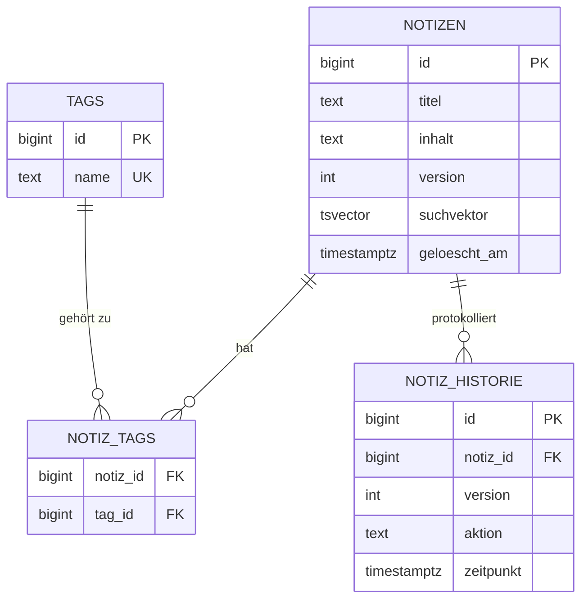

# Wissensdatenbank

Spring-Boot-Backend für Notizen mit Volltextsuche, Tags und automatischer Änderungshistorie. Die Logik liegt bewusst in PostgreSQL, der Zugriff erfolgt per `JdbcClient` mit reinem SQL.

## Technologien

Java 21, Spring Boot, Spring JDBC (`JdbcClient`), PostgreSQL 16, Flyway, Docker Compose

## Kernideen

- **Volltextsuche:** Eine Generated Column `suchvektor` (`tsvector`, deutsche Konfiguration) wird von PostgreSQL automatisch gepflegt. Der Titel wird höher gewichtet als der Inhalt. Ein **GIN-Index** macht die Suche schnell. Wortformen werden gefunden ("Transaktion" findet "Transaktionen").
- **Änderungshistorie per Trigger:** Jede Erstellung, Änderung und Löschung wird in `notiz_historie` protokolliert, unabhängig davon, welcher Code die Daten ändert.
- **Soft Delete:** Notizen werden nur mit `geloescht_am` markiert und bleiben in der Historie nachvollziehbar.
- **Warum JDBC statt JPA?** Volltextsuche, Generated Columns und Trigger sind reines SQL. Mit `JdbcClient` bleibt die Abfrage sichtbar und kontrollierbar.

## Starten

```bash
docker compose up -d
DB_URL=jdbc:postgresql://localhost:5434/wissen_db ./mvnw spring-boot:run
```

Die App läuft auf Port 8082.

## Endpunkte

| Methode | Pfad | Beschreibung |
|---|---|---|
| POST | `/notizen` | Notiz anlegen |
| GET | `/notizen/{id}` | Notiz lesen |
| PUT | `/notizen/{id}` | Notiz ändern (Version +1) |
| DELETE | `/notizen/{id}` | Soft Delete |
| GET | `/notizen/suche?q=...&tag=...&seite=0&groesse=10` | Volltextsuche mit Ranking und Auszug |
| GET | `/notizen/{id}/historie` | Änderungshistorie |

```bash
curl "http://localhost:8082/notizen/suche?q=transaktion"
```

## Datenmodell



## Nächste Schritte

- Integrationstests mit Testcontainers
- Pagination mit Keyset statt OFFSET bei sehr großen Datenmengen